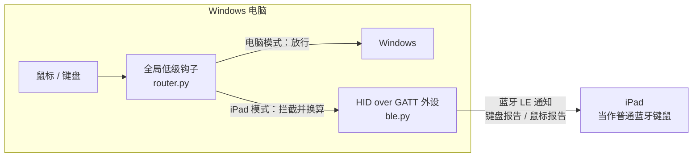

# iPad Bridge

**用 Windows 电脑自带的蓝牙，把电脑变成 iPad 的蓝牙键盘鼠标。鼠标推过屏幕边缘就"穿越"到 iPad，直接操作 iPad 上的 App。**

类似苹果的"通用控制（Universal Control）"，但用在 Windows 和 iPad 之间：
不需要额外硬件，不需要在 iPad 上装 App，不需要投屏。

[English](README_EN.md) · [更新日志](CHANGELOG.md) · MIT 开源协议

---

## 目录

- [它能做什么](#它能做什么)
- [工作原理](#工作原理)
- [运行要求](#运行要求)
- [安装](#安装)
- [第一次配对](#第一次配对)
- [日常使用](#日常使用)
- [配置说明](#配置说明)
- [常见问题与排查](#常见问题与排查)
- [安全与隐私](#安全与隐私)
- [已知限制](#已知限制)
- [项目结构](#项目结构)
- [开发与调试](#开发与调试)
- [路线图](#路线图)
- [致谢与参考](#致谢与参考)
- [协议](#协议)

## 它能做什么

- **鼠标穿越**：鼠标推过最外侧显示器的边缘（默认右边），就切换到 iPad，iPad 上出现指针；在 iPad 上往回推过边缘，就回到电脑。
- **完整键鼠**：移动、左键、右键、中键、滚轮、键盘（含组合键、方向键、F1–F12、小键盘）全部转给 iPad。
- **快捷键切换**：`Ctrl+Alt+Q`（可改）随时在电脑和 iPad 之间切换。
- **自动重连**：配对一次后，程序启动 iPad 就自动连上；iPad 断开时自动切回电脑，不会把键鼠"困"在 iPad 上。
- **自动恢复**：蓝牙适配器卡住、广播中断、重启程序后 iPad "连着却不响应"等情况会自动处理；托盘菜单也可以一键"重置蓝牙"。
- **手感优化**：控制 iPad 时临时关闭 Windows 鼠标加速（避免与 iPad 自带加速叠加发飘），鼠标移动以 4ms 匀速合并发送。
- **托盘图标**：灰色 = 等待 iPad 连接，蓝色 = 已连接、键鼠在电脑上，绿色 = 正在控制 iPad。

## 工作原理



1. **蓝牙键鼠（`ble.py`）**：通过 Windows 自带的 WinRT 接口 `GattServiceProvider`，在电脑上发布一个标准的 *HID over GATT*（HOGP）服务，包含键盘（Report ID 1）和鼠标（Report ID 2）。iPad 把电脑当成一个普通的蓝牙键鼠，不需要任何 App。
2. **输入路由（`router.py`）**：安装全局低级键鼠钩子（`WH_MOUSE_LL` / `WH_KEYBOARD_LL`）。
   - 电脑模式：所有输入照常交给 Windows，只在鼠标推过外侧边缘时切换。
   - iPad 模式：拦截电脑的键鼠输入，把电脑指针固定在屏幕中央，只用来测量每次移动的位移，再把位移、按键、滚轮换算成 HID 报告发给 iPad。
3. **回到电脑的判断**：iPadOS 的鼠标加速关不掉，程序无法精确知道 iPad 指针的位置。所以切过去时，先把 iPad 指针"推"到靠电脑那一侧的边缘对齐；之后程序维护一个虚拟位置，往回推到边缘并继续推一段（`return_push`）就回到电脑。

## 运行要求

| 项目 | 要求 |
|---|---|
| 系统 | Windows 10 2004（build 19041）及以上，或 Windows 11 |
| 蓝牙 | 支持 **LE 外设（Peripheral）模式** 的蓝牙适配器（启动时自动检测，不支持会提示）。实测 Realtek RTL8761B（BT 5.0 USB）可用 |
| Python | 3.10 及以上（开发使用 3.14） |
| iPad | iPadOS 13.4 及以上（系统原生支持鼠标指针） |

不需要 .NET、不需要管理员权限、不需要驱动。

## 安装

**方式一：下载源码运行（推荐）**

```bat
git clone https://github.com/a1103688841/ipad-bridge.git
cd ipad-bridge
setup.bat
```

`setup.bat` 会用 `py` 或 `python` 创建虚拟环境 `.venv` 并安装依赖。指定 Python：`setup.bat C:\Python314\python.exe`。

**方式二：pip 安装**

```bat
pip install git+https://github.com/a1103688841/ipad-bridge.git
ipad-bridge-tray      :: 后台运行（无窗口）
ipad-bridge           :: 带控制台运行（看日志）
```

pip 安装时，配置和日志放在 `%LOCALAPPDATA%\ipad-bridge\`；源码运行时放在项目目录。

## 第一次配对

1. 运行程序（`start.bat`），右下角托盘出现灰色平板图标。
2. 在电脑上打开 **设置 → 设备 → 蓝牙和其他设备**（托盘菜单"配对新 iPad"可一键打开），**配对完成前不要关这个页面**。
   > Windows 只在这个页面打开时接受其他设备主动发起的配对，否则会直接拒绝（系统日志 `BTHUSB` 事件 37："传入的身份验证请求被拒绝"）。
3. iPad：**设置 → 蓝牙**，在"其他设备"里点电脑的名字（如 `DESKTOP-XXXXXXX`）。
   > 可能会出现**两个同名**条目：一个是本程序模拟的键鼠，一个是电脑本身。选连上后不会断开、托盘变蓝的那个。
4. 电脑右下角弹出配对通知时点"允许"；如果两边显示数字，确认一致后点确认。
5. 托盘图标变成**蓝色**就成功了。

以后只要程序在运行、iPad 蓝牙开着，就会自动连上，不需要再打开蓝牙设置页。

## 日常使用

| 操作 | 效果 |
|---|---|
| 鼠标推过最外侧显示器的边缘（默认右边） | 切到 iPad，iPad 指针从靠电脑一侧的边缘出现 |
| 在 iPad 上往回推过靠电脑一侧的边缘 | 回到电脑，指针回到离开时的位置 |
| `Ctrl+Alt+Q` | 任何时候在电脑 / iPad 之间切换 |
| 单击托盘图标 | 同上，切换 |
| iPad 断开 / 关蓝牙 | 自动回到电脑 |

**按键对应（默认）**

| 电脑 | iPad |
|---|---|
| `Win` | `Command ⌘` |
| `Alt` | `Option ⌥` |
| `Ctrl` | `Control ⌃` |
| `Win+H` | 回主屏幕 |
| `Win+空格` | 搜索 |
| `Win+Tab` | 切换 App |

想用 `Ctrl+C` / `Ctrl+V` 复制粘贴，把配置里的 `ctrl_as_cmd` 改成 `true`（Ctrl 和 Win 互换）。
中文输入使用 iPad 自己的输入法：`Ctrl+空格`（或在 iPad 设置里开启"用大写锁定键切换"后按 `Caps Lock`）。

**开机自启**：按 `Win+R` 输入 `shell:startup`，把 `start.bat` 的快捷方式放进去。

**托盘菜单**

- 切换到 iPad / 切回电脑
- 重置蓝牙（iPad 连不上时用）：关掉蓝牙再打开，重新发布键鼠服务
- 配对新 iPad（打开蓝牙设置）
- 打开配置文件 / 打开日志
- 退出

## 配置说明

第一次运行会生成 `ipad-bridge.ini`（每项都有中文注释），改完**重启程序**生效。

| 配置项 | 默认值 | 说明 |
|---|---|---|
| `side` | `right` | iPad 放在电脑屏幕哪一边：`right` / `left`。以所有显示器拼起来的最外侧边缘为准 |
| `hotkey` | `ctrl+alt+q` | 切换快捷键。可用 `ctrl` `alt` `shift` `win` + 字母/数字/`f1`–`f24`/`space` `tab` `esc` `home` `end` `pageup` `pagedown` `insert` `delete` `pause` `scrolllock` 等，例如 `ctrl+shift+f12`、`scrolllock` |
| `speed` | `1.0` | 发给 iPad 的鼠标移动倍率。也可以在 iPad 的"设置 → 通用 → 触控板与鼠标 → 跟踪速度"调 |
| `scroll` | `1` | 滚轮每格滚动行数 |
| `disable_windows_accel` | `true` | 控制 iPad 时临时关闭 Windows"提高指针精确度"，回到电脑自动恢复。避免两层加速叠加导致发飘 |
| `motion_interval_ms` | `4` | 鼠标移动合并发送的间隔（毫秒）。越小越跟手，太小会挤占蓝牙带宽 |
| `edge_dwell` | `3` | 在屏幕边缘连续往外推多少次才切到 iPad（防误切） |
| `ipad_width` | `1600` | iPad 的"虚拟宽度"（电脑鼠标移动量），用于判断何时回到电脑。回来得太早就调大，要推很久才回来就调小 |
| `return_push` | `200` | 到达 iPad 靠电脑一侧边缘后，还要继续往回推多少才回到电脑 |
| `ctrl_as_cmd` | `false` | `true`：Ctrl 当 Command、Win 当 Control |

## 常见问题与排查

<details>
<summary><b>启动提示"蓝牙适配器不支持外设（Peripheral）模式"</b></summary>

适配器硬件或驱动不支持 LE 外设角色，本程序无法工作。可换一个支持的蓝牙适配器（大多数 BT 5.0 的 USB 适配器和较新的 Intel 无线网卡都支持），并更新驱动。
</details>

<details>
<summary><b>iPad 蓝牙列表里找不到电脑</b></summary>

- 确认程序在运行（托盘有图标）。
- 打开电脑的"蓝牙和其他设备"页面。
- iPad 关闭蓝牙再打开，等十几秒刷新。
</details>

<details>
<summary><b>点了配对，iPad 短暂"已连接"后又断开、消失</b></summary>

Windows 拒绝了配对请求。第一次配对时必须**打开电脑的蓝牙设置页面**，并及时点击右下角的配对通知。在"事件查看器 → Windows 日志 → 系统"里能看到 `BTHUSB` 事件 37。
</details>

<details>
<summary><b>重启程序后 iPad 显示已连接，但没有反应（托盘一直是灰色）</b></summary>

蓝牙连接由 Windows 维持，程序重启后 iPad 可能停留在旧连接上，不重新订阅新的键鼠服务。程序启动 6 秒后会自动检测这种情况并重置蓝牙；也可以手动点托盘的"重置蓝牙"，或在 iPad 蓝牙列表里点一下电脑的名字。
</details>

<details>
<summary><b>用着用着断开 / 一卡一卡，系统日志有"发送到适配器的命令已经超时"</b></summary>

`BTHUSB` 事件 3 表示 USB 蓝牙适配器没有响应，常见原因是 USB 省电挂起。关闭插电时的"USB 选择性暂停"：

```bat
powercfg /setacvalueindex SCHEME_CURRENT 2a737441-1930-4402-8d77-b2bebba308a3 48e6b7a6-50f5-4782-a5d4-53bb8f07e226 0
powercfg /setactive SCHEME_CURRENT
```

并在设备管理器 → 蓝牙适配器 → 属性 → 电源管理中取消"允许计算机关闭此设备以节约电源"。适配器卡住后程序会自动重新广播；仍连不上时点托盘"重置蓝牙"。
</details>

<details>
<summary><b>iPad 上指针发飘、不跟手、一顿一顿</b></summary>

- 确认 `disable_windows_accel = true`（默认）。
- 减小 `motion_interval_ms`（如 `2`），或在 iPad 上调低"跟踪速度"。
- 避免同时用同一个蓝牙适配器听音乐（蓝牙耳机会抢占带宽）。
- 用 `run.bat` 运行，日志里每 5 秒会输出 `sent N motion/s, notify avg/worst ms`，可据此判断是否是蓝牙发送变慢。
</details>

<details>
<summary><b>刚切到 iPad 就弹回电脑 / 回电脑太早或太晚</b></summary>

- 切过去后 iPad 指针在靠电脑一侧的边缘，此时继续往回推就会回到电脑，这是设计行为。觉得太容易回来就调大 `return_push`。
- 在 iPad 中间往回移就回到电脑（回得太早）：调大 `ipad_width`；要推很久才回来：调小 `ipad_width`。
- 也可以完全用快捷键切换。
</details>

<details>
<summary><b>键鼠"卡"在 iPad 上回不来</b></summary>

依次尝试：按 `Ctrl+Alt+Q` → 关闭 iPad 蓝牙（程序会自动切回电脑） → `Ctrl+Alt+Del` 打开任务管理器结束 `python` 进程。
程序退出后钩子会被系统自动移除；如果程序在 iPad 模式下被强制结束，被临时关闭的 Windows 鼠标加速会在下次启动时自动恢复（注销重新登录也会恢复）。
</details>

<details>
<summary><b>提示"iPad Bridge 已经在运行了"</b></summary>

同一时间只能运行一个实例。看右下角托盘（可能在折叠区里），或在任务管理器里结束旧的 `python` / `pythonw` 进程。
</details>

## 安全与隐私

- 不联网，不上传任何数据；只通过本机蓝牙和**已配对**的 iPad 通信。
- 蓝牙通信要求加密（HID 规范要求），只有配对过的设备能读取键鼠数据。
- 键盘钩子只在 iPad 模式下把按键转发给 iPad；**日志不记录任何按键内容**。
- 修改 Windows 鼠标设置只在当前会话生效、不写入注册表，并在回到电脑时恢复。

## 已知限制

- 在 iPad 模式下，电脑指针停在屏幕中央（可见但不动）。
- 鼠标侧键、横向滚轮暂不转发；没有剪贴板共享。
- iPad 指针位置是估算的（iPadOS 鼠标加速无法关闭），"推回电脑"的时机可能需要按个人习惯调参数。
- 蓝牙设备名就是电脑名，暂时不能自定义。
- 修改 HID 报告描述（`hid.py` 的 `REPORT_MAP`）后，iPad 需要"忽略此设备"重新配对（iPad 会缓存设备描述）。

## 项目结构

```
ipad-bridge/
├─ ipad_bridge/
│  ├─ __main__.py   入口：单实例、日志、配置、各模块组装
│  ├─ ble.py        HID over GATT 外设：发布服务、发送报告、连接检测、自动恢复
│  ├─ router.py     全局键鼠钩子：边缘检测、模式切换、输入换算
│  ├─ hid.py        HID 报告描述、Windows 虚拟键 → HID 键码映射
│  ├─ config.py     ipad-bridge.ini 读取与默认值
│  ├─ tray.py       托盘图标与菜单
│  └─ win32.py      Win32 API（ctypes）声明
├─ setup.bat        创建 .venv 并安装依赖
├─ start.bat        后台运行（只有托盘图标）
├─ run.bat          带控制台运行（调试）
├─ requirements.txt
└─ pyproject.toml   pip 安装 / 打包
```

## 开发与调试

- 用 `run.bat` 运行可以实时看日志；日志文件是 `ipad-bridge.log`（1MB 滚动）。
- 每次切到 iPad，日志会记录前 20 次鼠标移动（`trace #n pt=... d=... vx=...`），以及切回时的停留时间和鼠标事件频率。
- 发送统计：`sent N motion/s + M other in 5.0s, notify avg X ms, worst Y ms`。
- 系统层面的蓝牙问题看"事件查看器 → Windows 日志 → 系统"，来源 `BTHUSB`。
- 代码约定：钩子回调和模式状态只在主线程（消息循环）里修改；蓝牙相关调用只在 `ble` 线程（asyncio）里执行；两边通过线程安全的方法和 `PostThreadMessage` 通信。

## 路线图

- [ ] 绝对坐标定位 iPad 指针（参考 MouseLink 的做法），彻底解决"回电脑时机"的估算误差
- [ ] 鼠标侧键、横向滚动、媒体键
- [ ] iPad 模式下隐藏电脑指针
- [ ] 托盘里一键开启开机自启
- [ ] 打包成单个 exe

欢迎提 Issue 和 Pull Request。

## 致谢与参考

- [abhishek-raj/windows-ble-hid](https://github.com/abhishek-raj/windows-ble-hid)：证明了 Windows 自带蓝牙栈可以作为 HID over GATT 外设
- [tukitohosi/mouselink](https://github.com/tukitohosi/mouselink)：ESP32 方案的 Windows → iPad 键鼠穿越，绝对坐标思路
- [hrvach/deskhop](https://github.com/hrvach/deskhop)、[deskflow/deskflow](https://github.com/deskflow/deskflow)：屏幕边缘切换的交互设计
- [pywinrt](https://github.com/pywinrt/pywinrt)：Python 调用 WinRT
- [pystray](https://github.com/moses-palmer/pystray)：托盘图标

## 协议

[MIT](LICENSE)
