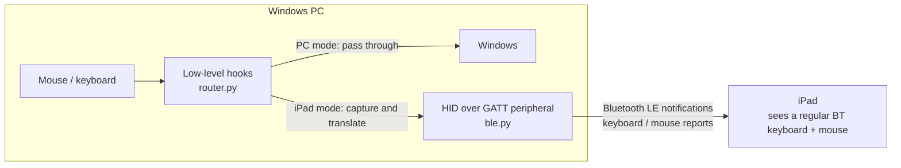

# iPad Bridge

**Turn a Windows PC's built-in Bluetooth into a keyboard and mouse for your iPad. Push the cursor past the edge of the screen and keep working on the iPad, in the iPad's own apps.**

Think of Apple's Universal Control, but between Windows and an iPad: no extra hardware, no app on the iPad, no screen mirroring.

[中文说明](README.md) · [Changelog](CHANGELOG.md) · MIT License

## Features

- **Cross the screen edge**: push the pointer past the outer edge of your monitors (right by default) to control the iPad; push back past the iPad's edge to return.
- **Full keyboard and mouse**: motion, left/right/middle buttons, wheel and the keyboard (shortcuts, arrows, F1–F12, keypad) all go to the iPad.
- **Hotkey**: `Ctrl+Alt+Q` (configurable) switches between PC and iPad at any time.
- **Auto reconnect**: once paired, the iPad reconnects whenever the program runs; if it disconnects, input returns to the PC automatically.
- **Self-healing**: recovers from a stuck Bluetooth adapter, dropped advertising, or an iPad that stays linked without re-subscribing after a restart. The tray menu also has a one-click "reset Bluetooth".
- **Smooth pointer**: Windows pointer acceleration is switched off while you control the iPad (the iPad applies its own) and motion is sent at a steady 4 ms cadence.
- **Tray icon**: grey = waiting for the iPad, blue = connected (input on the PC), green = controlling the iPad.

## How it works



1. `ble.py` publishes a standard **HID over GATT** service (keyboard = report ID 1, mouse = report ID 2) through the WinRT `GattServiceProvider` API of the built-in Windows Bluetooth stack.
2. `router.py` installs `WH_MOUSE_LL` / `WH_KEYBOARD_LL` hooks. In iPad mode it swallows PC input, parks the PC pointer in the middle of the screen to measure each movement, and turns movements, buttons, wheel and keys into HID reports.
3. iPadOS pointer acceleration cannot be disabled, so the iPad pointer position is estimated: on entry the iPad pointer is pinned to the edge next to the PC, and a virtual position decides when you've pushed back far enough (`return_push`) to return.

## Requirements

- Windows 10 2004 (build 19041) or later, or Windows 11
- A Bluetooth adapter that supports the **LE peripheral role** (checked at startup; tested with a Realtek RTL8761B USB dongle)
- Python 3.10+ (developed on 3.14)
- iPadOS 13.4+ (native pointer support)

No .NET, no admin rights, no drivers.

## Install

From source (recommended):

```bat
git clone https://github.com/a1103688841/ipad-bridge.git
cd ipad-bridge
setup.bat                         :: creates .venv and installs dependencies
start.bat                         :: run in the background (tray icon only)
run.bat                           :: run with a console window and live log
```

With pip:

```bat
pip install git+https://github.com/a1103688841/ipad-bridge.git
ipad-bridge-tray                  :: background
ipad-bridge                       :: console
```

Settings and logs live in the project folder when run from source, or in `%LOCALAPPDATA%\ipad-bridge\` when installed with pip.

## First pairing

1. Start the program; a grey tablet icon appears in the tray.
2. On the PC open **Settings → Devices → Bluetooth & other devices** (tray menu: "配对新 iPad") and **keep it open until pairing is done**. Windows only accepts incoming pairing requests while that page is open; otherwise it rejects them (System log, `BTHUSB` event 37).
3. On the iPad: **Settings → Bluetooth**, tap the PC's name under "Other Devices". If two entries with the same name show up, one is the emulated keyboard/mouse and one is the PC itself; use the one that stays connected.
4. Accept the pairing notification on the PC (confirm the numbers if both sides show them).
5. The tray icon turns **blue**. From now on the iPad reconnects by itself.

## Usage

| Action | Result |
|---|---|
| Push past the outer screen edge (right by default) | Control the iPad; its pointer appears at the edge next to the PC |
| Push back past that edge on the iPad | Back to the PC |
| `Ctrl+Alt+Q` / click the tray icon | Toggle PC ↔ iPad |
| iPad disconnects | Back to the PC automatically |

Key mapping: `Win` = Command, `Alt` = Option, `Ctrl` = Control. Set `ctrl_as_cmd = true` to use `Ctrl+C`/`Ctrl+V` for copy/paste. Use the iPad's own input methods for non-Latin text.

Autostart: `Win+R` → `shell:startup`, put a shortcut to `start.bat` there.

## Configuration (`ipad-bridge.ini`)

| Key | Default | Meaning |
|---|---|---|
| `side` | `right` | Which side of the desktop the iPad sits on: `right` / `left` |
| `hotkey` | `ctrl+alt+q` | Toggle hotkey, e.g. `ctrl+shift+f12`, `scrolllock` |
| `speed` | `1.0` | Multiplier for pointer motion sent to the iPad |
| `scroll` | `1` | Lines per wheel notch |
| `disable_windows_accel` | `true` | Turn off Windows pointer acceleration while controlling the iPad |
| `motion_interval_ms` | `4` | Cadence for merged mouse motion reports |
| `edge_dwell` | `3` | Mouse events pushing into the edge before switching to the iPad |
| `ipad_width` | `1600` | Virtual iPad width (PC mouse counts) used to detect the return edge |
| `return_push` | `200` | How far to keep pushing at the iPad's edge before returning |
| `ctrl_as_cmd` | `false` | `true`: Ctrl acts as Command and Win as Control |

Restart the program after editing.

## Troubleshooting

- **"Adapter does not support the peripheral role"**: use another Bluetooth adapter / update its driver.
- **iPad connects briefly then disappears**: pairing was rejected; keep the Windows Bluetooth settings page open while pairing and accept the notification.
- **iPad shows connected but nothing happens after restarting the program**: the iPad kept the old link without re-subscribing. The program detects this after 6 s and resets Bluetooth; or use the tray's "reset Bluetooth".
- **Drops or stutters, System log `BTHUSB` event 3 ("command to the adapter timed out")**: disable USB selective suspend:
  `powercfg /setacvalueindex SCHEME_CURRENT 2a737441-1930-4402-8d77-b2bebba308a3 48e6b7a6-50f5-4782-a5d4-53bb8f07e226 0` then `powercfg /setactive SCHEME_CURRENT`, and untick "Allow the computer to turn off this device" for the adapter in Device Manager.
- **Pointer feels floaty**: keep `disable_windows_accel = true`, lower `motion_interval_ms`, or lower the iPad's tracking speed. `run.bat` logs `sent N motion/s, notify avg/worst ms` every 5 s.
- **Returns to the PC too early/late**: raise/lower `ipad_width`; raise `return_push` if you bounce back right after crossing.
- **Stuck on the iPad**: `Ctrl+Alt+Q` → turn off Bluetooth on the iPad → `Ctrl+Alt+Del` and end the `python` process. Hooks are removed when the process exits, and Windows pointer settings are restored on the next start.

## Privacy

No network access. Data goes only to the paired iPad over encrypted Bluetooth LE. Keystrokes are never logged. Pointer setting changes are session-only and restored when you return to the PC.

## Known limitations

- The PC pointer stays visible (but still) in the middle of the screen while you control the iPad.
- Side buttons, horizontal scrolling and clipboard sharing are not supported yet.
- The iPad pointer position is estimated, so the return point may need tuning.
- The Bluetooth name is the PC's name.
- Changing `REPORT_MAP` requires "Forget This Device" on the iPad and pairing again.

## Roadmap

- Absolute pointer positioning on the iPad (as in MouseLink) for an exact return edge
- Side buttons, horizontal scroll, media keys
- Hide the PC pointer in iPad mode
- Autostart toggle in the tray
- Single-file executable

Issues and pull requests are welcome.

## Credits

[windows-ble-hid](https://github.com/abhishek-raj/windows-ble-hid) · [MouseLink](https://github.com/tukitohosi/mouselink) · [DeskHop](https://github.com/hrvach/deskhop) · [Deskflow](https://github.com/deskflow/deskflow) · [pywinrt](https://github.com/pywinrt/pywinrt) · [pystray](https://github.com/moses-palmer/pystray)

## License

[MIT](LICENSE)
